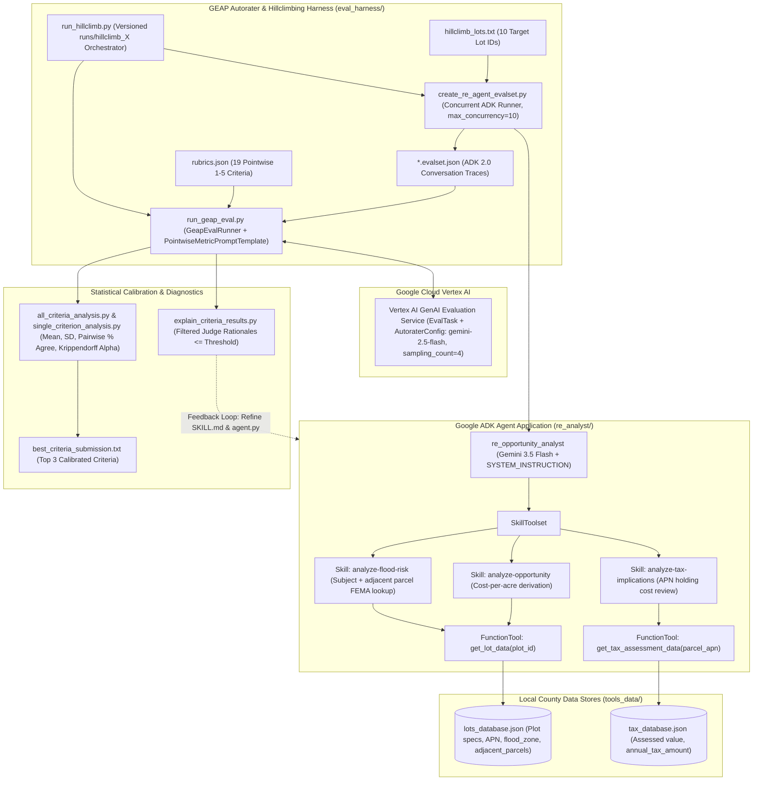
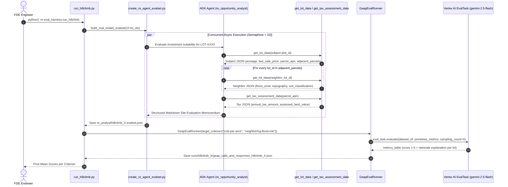

# FDE: Hillclimbing with Autoraters — Step-by-Step Lab Runbook

> [!NOTE]
> This runbook documents the end-to-end architecture, workflow, statistical autorater calibration, and iterative agent hillclimbing steps for the **Forward Deployed Engineering (FDE): Hillclimbing with Autoraters Challenge Lab** on Google Cloud Vertex AI and the Agent Development Kit (ADK).

---

## 1. Lab Overview & Objectives

In production AI engineering, improving a multi-tool agent systematically ("**hillclimbing**") requires two foundations:
1. **Calibrated, Reliable Autoraters**: Pointwise LLM-as-a-Judge rubrics that achieve both high inter-rater agreement (**Krippendorff's Alpha** $\alpha \ge 0.80$) across stochastic passes and meaningful discriminative spread across candidate outputs.
2. **Evidence-Driven Agent Iteration**: Using structured judge rationales on low-scoring criteria to diagnose missing tool calls, incomplete skill instructions, or formatting gaps—without overfitting or fabricating missing records.

### Key Lab Milestones
| Phase | Objective | Key Artifact / Result |
| :--- | :--- | :--- |
| **Phase 1** | Configure Python 3.13, Vertex AI environment, and generate ADK agent traces across 10 target land parcels | `re_analyst/hillclimb_lots.evalset.json` |
| **Phase 2** | Run multi-pass ($k=3$) Vertex AI GenAI Evaluation Service (`GEAP`) pointwise rubrics & analyze inter-rater reliability | `runs/baseline/geap_calls_and_responses.json` |
| **Phase 3** | Identify the top 3 well-calibrated, discriminative rubrics from 19 candidate criteria using Krippendorff's $\alpha$ and report SD | `monthly-tax-holding,flood-zone-flagging,environmental-esa` |
| **Phase 4** | Diagnose baseline agent failures (`1.00` / `1.00`) and hillclimb ADK skills + system instructions to perfection | `cost-per-acre`: **5.0000**, `neighboring-flood-risk`: **5.0000** |

---

## 2. System Architecture

The solution integrates an **ADK 2.4 Real Estate Analyst Agent** (`gemini-3.5-flash`) equipped with modular domain skills and local JSON property/tax databases, paired with an automated **Vertex AI GenAI Evaluation Service (GEAP)** harness (`gemini-2.5-flash` autorater judge) and a statistical reliability engine.



---

## 3. End-to-End Workflow & Execution Diagrams

### 3.1 Lab Execution Pipeline

```mermaid
flowchart LR
    S1["1. Setup & Config (Python 3.13, .env, ADC)"] --> S2["2. Trace Generation (create_re_agent_evalset)"]
    S2 --> S3["3. GEAP Evaluation (Dry-Run -> Live k=3 Passes)"]
    S3 --> S4["4. Rubric Calibration (Krippendorff Alpha Analysis)"]
    S4 --> S5["5. Submit Best 3 Criteria (GCS Bucket Upload)"]
    S5 --> S6["6. Baseline Hillclimb (hillclimb_1 & hillclimb_2)"]
    S6 --> S7["7. Failure Diagnosis (explain_criteria_results)"]
    S7 --> S8["8. Skill & Prompt Update (SKILL.md + agent.py)"]
    S8 --> S9["9. Verification Run (hillclimb_3 -> 5.0 / 5.0)"]
```



### 3.2 Runtime Sequence: Agent Trace Generation & GEAP Scoring



### 3.3 Iterative Hillclimbing Workflow

```mermaid
stateDiagram-v2
    [*] --> Baseline_Run_1
    Baseline_Run_1: hillclimb_1 (Baseline Agent)
    Baseline_Run_1: cost-per-acre = 1.0000 | neighboring-flood-risk = 1.0000

    Baseline_Run_1 --> Inspect_Rationales: explain_criteria_results (--max_score_to_show 4.0)
    Inspect_Rationales: Diagnose Judge Explanations
    Inspect_Rationales: 1. Price & acreage listed separately without $/acre formula
    Inspect_Rationales: 2. Only subject flood_zone checked; adjacent_parcels ignored

    Inspect_Rationales --> Baseline_Run_2: Re-run check for stochastic variance
    Baseline_Run_2: hillclimb_2 (Variance Check)
    Baseline_Run_2: cost-per-acre = 1.1000 | neighboring-flood-risk = 1.2000

    Baseline_Run_2 --> Refine_Agent: Targeted Skill & Prompt Engineering
    Refine_Agent: Update Agent & Skills
    Refine_Agent: - analyze-opportunity/SKILL.md (explicit formula & label)
    Refine_Agent: - analyze-flood-risk/SKILL.md (add get_lot_data + neighbor loop + table)
    Refine_Agent: - re_analyst/agent.py (MANDATORY EVALUATION REQUIREMENTS + anti-hallucination)

    Refine_Agent --> Verification_Run_3: Execute run_hillclimb
    Verification_Run_3: hillclimb_3 (Optimized Agent)
    Verification_Run_3: cost-per-acre = 5.0000 | neighboring-flood-risk = 5.0000

    Verification_Run_3 --> [*]
```



---

## 4. Repository Structure

```text
.
├── .env.example                          # Template environment configuration for Vertex AI & ADK
├── LAB_RUNBOOK.md                        # Complete step-by-step runbook, architecture & metrics
├── README.md                             # Project overview and quickstart guide
├── best_criteria_submission.txt          # Top 3 calibrated autorater criteria selected in Phase 2
├── requirements.txt                      # Pinned Python 3.13 dependencies (google-adk, vertexai, krippendorff)
├── tools_data/
│   ├── lots_database.json                # County parcel records (acreage, price, flood_zone, adjacent_parcels)
│   └── tax_database.json                 # County tax assessment records keyed by parcel_apn
├── re_analyst/                           # Google ADK Agent Package
│   ├── agent.py                          # Root Agent (re_opportunity_analyst), SkillToolset & system prompt
│   ├── tools/
│   │   ├── lot_tool.py                   # FunctionTool: get_lot_data(plot_id) with in-memory cache
│   │   └── tax_tool.py                   # FunctionTool: get_tax_assessment_data(parcel_apn)
│   ├── skills/
│   │   ├── analyze-opportunity/SKILL.md  # Acquisition analysis & explicit cost-per-acre calculation
│   │   ├── analyze-flood-risk/SKILL.md   # Subject + neighboring parcel FEMA flood-zone & drainage skill
│   │   └── analyze-tax-implications/SKILL.md # APN lookup & carrying tax assessment skill
│   ├── hillclimb_lots.evalset.json       # Baseline ADK EvalSet traces across 10 target lots
│   ├── hillclimb_1.evalset.json          # Hillclimb Iteration 1 traces (baseline)
│   ├── hillclimb_2.evalset.json          # Hillclimb Iteration 2 traces (baseline variance check)
│   └── hillclimb_3.evalset.json          # Hillclimb Iteration 3 traces (post-optimization -> 5.0/5.0)
├── eval_harness/                         # GEAP Evaluation & Statistical Analysis Suite
│   ├── create_re_agent_evalset.py        # Concurrent ADK Runner that populates EvalSet JSON traces
│   ├── run_geap_eval.py                  # Bridge from ADK traces to Vertex AI GenAI Eval Service
│   ├── rubrics.json                      # 19 candidate pointwise rubrics (1-5 rating scales)
│   ├── metrics_calc.py                   # Krippendorff's Alpha (interval), Pairwise % Agreement, SDs
│   ├── all_criteria_analysis.py          # Global summary table across all evaluated criteria
│   ├── single_criterion_analysis.py      # N x k item-by-pass grades matrix & stats for one criterion
│   ├── explain_criteria_results.py       # Filters & displays LLM judge explanations below a score cutoff
│   ├── run_hillclimb.py                  # Automated hillclimb loop orchestrator (versioned runs/hillclimb_X)
│   ├── hillclimb_lots.txt                # 10 target edge-case Lot IDs (LOT-8472, LOT-8471, ..., LOT-1006)
│   └── utils.py                          # Dynamic ADK app loader & DataFrame pivoting helpers
└── runs/                                 # Saved GEAP Prompts, Judge Scores & Explanations
    ├── geap_calls_and_responses_for_analysis.json # Multi-pass benchmark dataset for rubric calibration
    ├── baseline/geap_calls_and_responses.json     # Live k=3 baseline run across all 19 criteria
    ├── hillclimb_1/geap_calls_and_responses_hillclimb_1.json
    ├── hillclimb_2/geap_calls_and_responses_hillclimb_2.json
    └── hillclimb_3/geap_calls_and_responses_hillclimb_3.json
```

---

## 5. Step-by-Step Execution Runbook

### Step 1: Environment Setup & Vertex AI Configuration

Authenticate Application Default Credentials (ADC), copy the lab workspace from Cloud Storage, install **Python 3.13** via `pyenv`, and install dependencies.

```bash
# 1. Authenticate and set your GCP Project
gcloud auth application-default login
export PROJECT_ID="<YOUR_GCP_PROJECT_ID>"
gcloud config set project "${PROJECT_ID}"

# 2. Download lab artifacts from the lab GCS bucket (if starting fresh in Cloud Shell)
gcloud storage cp -r "gs://${PROJECT_ID}-bucket/autoraters" .

# 3. Install Python 3.13 via pyenv
sudo apt-get update && sudo apt-get install -y libreadline-dev
curl https://pyenv.run | bash
export PYENV_ROOT="$HOME/.pyenv"
export PATH="$PYENV_ROOT/bin:$PATH"
eval "$(pyenv init -)"
pyenv install 3.13
pyenv global 3.13
python3 --version

# 4. Install required Python packages
cd ~/autoraters
python3 -m pip install -r requirements.txt
```

Create the `.env` configuration file inside the project root (`~/autoraters/.env`):

```bash
cat << EOF > .env
GOOGLE_GENAI_USE_VERTEXAI=TRUE
GOOGLE_CLOUD_PROJECT=${PROJECT_ID}
GOOGLE_CLOUD_LOCATION=global
MODEL=gemini-3.5-flash
EOF
```

---

### Step 2: Generate Baseline ADK Evaluation Traces

Run `eval_harness.create_re_agent_evalset` to execute `re_opportunity_analyst` concurrently (`max_concurrency=10`) across the 10 properties listed in `eval_harness/hillclimb_lots.txt` (`LOT-8472`, `LOT-8471`, `LOT-8473`, `LOT-1000`–`LOT-1006`) and serialize full ADK 2.0 conversation traces.

```bash
python3 -m eval_harness.create_re_agent_evalset \
  --lots-file eval_harness/hillclimb_lots.txt \
  --out ./re_analyst/hillclimb_lots.evalset.json \
  --agent-dir ./re_analyst
```

**Verification:**
```bash
ls -lh re_analyst/hillclimb_lots.evalset.json
```

---

### Step 3: Execute GEAP Autorater Evaluation (Dry-Run & Live Multi-Pass)

First, run `eval_harness.run_geap_eval` with `--dry-run` to validate trace extraction and `PointwiseMetricPromptTemplate` prompt assembly without invoking cloud API calls:

```bash
python3 -m eval_harness.run_geap_eval \
  --traces re_analyst/hillclimb_lots.evalset.json \
  --rubric-file eval_harness/rubrics.json \
  --out runs/baseline/geap_calls_and_responses.json \
  --experiment-name rubric-agreement-check \
  --dry-run \
  --k 3

# Inspect assembled prompt structure
python3 -m json.tool runs/baseline/geap_calls_and_responses.json | head -80
```

Next, remove `--dry-run` to dispatch **$k=3$ stochastic passes** across all 19 criteria (`10 traces × 19 criteria = 190 records`, 3 passes each) to Vertex AI's GenAI Evaluation Service (`gemini-2.5-flash` autorater with `judge_model_sampling_count=4`):

```bash
python3 -m eval_harness.run_geap_eval \
  --traces re_analyst/hillclimb_lots.evalset.json \
  --rubric-file eval_harness/rubrics.json \
  --out runs/baseline/geap_calls_and_responses.json \
  --experiment-name rubric-agreement-check \
  --k 3
```

---

### Step 4: Statistical Rubric Calibration & Best Criteria Selection

A trustworthy autorater criterion must satisfy **two statistical conditions simultaneously**:
1. **High Inter-Rater Reliability**: High **Krippendorff's Alpha** ($\alpha \ge 0.85$) and high **Pairwise Percent Agreement**, proving different passes score the same report consistently.
2. **True Discriminative Signal**: Non-trivial report-to-report variance (`sd report means` $> 0.30$), avoiding **ceiling effects** (where vague rubrics give every report `5/5`, yielding `sd_report_means = 0`) and **floor effects** (where nearly all reports score `1/5`).

Run the global summary across all 19 criteria on the calibration dataset:

```bash
python3 -m eval_harness.all_criteria_analysis \
  --run_geap_eval_out runs/geap_calls_and_responses_for_analysis.json
```

#### Calibration Results Across All 19 Candidate Criteria

| Criterion ID | Mean | Min | Max | SD Report Means | Pairwise % Agree | Krippendorff's $\alpha$ | Calibration Verdict |
| :--- | ---: | ---: | ---: | ---: | ---: | ---: | :--- |
| **`monthly-tax-holding`** | **2.2764** | **2** | **5** | **0.8872** | **99.17%** | **0.9970** | **Selected (Top #1 — Near-perfect $\alpha$ + strong spread)** |
| **`flood-zone-flagging`** | **4.8447** | **3** | **5** | **0.3357** | **94.41%** | **0.8970** | **Selected (Top #2 — High $\alpha$ + clear FEMA zone signal)** |
| **`environmental-esa`** | **4.2772** | **2** | **5** | **0.7042** | **79.10%** | **0.8970** | **Selected (Top #3 — High $\alpha$ + wide report discrimination)** |
| `risk-assessment` | 4.9532 | 3 | 5 | 0.1843 | 96.25% | 0.8030 | Runner-up (Slightly compressed near ceiling) |
| `utility-topography` | 4.7756 | 4 | 5 | 0.3081 | 82.57% | 0.7510 | Moderate reliability ($\alpha < 0.80$) |
| `general-tone` / `logical-flow` / `professionalism` / `readability` | 5.0000 | 5 | 5 | 0.0000 | 100.00% | 1.0000 | Reject — Ceiling effect (zero discrimination) |
| `neighboring-flood-risk` | 1.0316 | 1 | 2 | 0.1768 | 100.00% | 1.0000 | Floor effect on unoptimized baseline reports |
| `professional-tone` / `data-density` / `document-formatting` / `report-length` | 4.76–5.00 | 4 | 5 | 0.01–0.17 | 67–99% | 0.498–0.549 | Reject — Vague/subjective wording, noisy $\alpha$ |

Inspect individual $N \times k$ item-by-pass matrices to verify rating behavior:

```bash
python3 -m eval_harness.single_criterion_analysis \
  --run_geap_eval_out runs/geap_calls_and_responses_for_analysis.json \
  --criterion monthly-tax-holding

python3 -m eval_harness.single_criterion_analysis \
  --run_geap_eval_out runs/geap_calls_and_responses_for_analysis.json \
  --criterion flood-zone-flagging

python3 -m eval_harness.single_criterion_analysis \
  --run_geap_eval_out runs/geap_calls_and_responses_for_analysis.json \
  --criterion environmental-esa
```

Write and upload the top 3 calibrated criteria submission file:

```bash
cat > best_criteria_submission.txt <<'EOF'
monthly-tax-holding,flood-zone-flagging,environmental-esa
EOF

gcloud storage cp best_criteria_submission.txt "gs://${PROJECT_ID}-bucket/best_criteria_submission.txt"
```

---

### Step 5: Baseline Hillclimbing & Root-Cause Failure Analysis

Execute the hillclimbing harness (`eval_harness.run_hillclimb`), which runs the ADK agent across the 10 edge-case lots and evaluates the two target weak criteria (`cost-per-acre` and `neighboring-flood-risk`) at $k=1$, automatically versioning output folders under `runs/hillclimb_X/`:

```bash
python3 -m eval_harness.run_hillclimb
```

**Baseline Results (`hillclimb_1` & variance confirmation `hillclimb_2`):**
- `hillclimb_1`: `cost-per-acre` = **1.0000**, `neighboring-flood-risk` = **1.0000**
- `hillclimb_2`: `cost-per-acre` = **1.1000**, `neighboring-flood-risk` = **1.2000**

Inspect the judge rationales for low-scoring reports using `explain_criteria_results`:

```bash
python3 -m eval_harness.explain_criteria_results \
  --run_geap_eval_out runs/hillclimb_1/geap_calls_and_responses_hillclimb_1.json \
  --criterion cost-per-acre \
  --max_score_to_show 4.0

python3 -m eval_harness.explain_criteria_results \
  --run_geap_eval_out runs/hillclimb_1/geap_calls_and_responses_hillclimb_1.json \
  --criterion neighboring-flood-risk \
  --max_score_to_show 4.0
```

#### Root-Cause Diagnosis

> [!IMPORTANT]
> Inspecting the judge explanations alongside `re_analyst/skills/*/SKILL.md` and `tools_data/lots_database.json` revealed two structural gaps in the baseline agent:
> 1. **Missing Cost-Per-Acre Derivation (`cost-per-acre`)**: `analyze-opportunity/SKILL.md` instructed the agent to review `acreage` and `last_sale_price`, so the agent listed both numbers separately without computing $\text{Last Sale Price} / \text{Acreage}$, showing the formula, or highlighting **Acquisition Cost per Acre** as a core valuation metric (required for a `5/5` rubric score).
> 2. **Missing Neighboring Parcel Tool Lookups (`neighboring-flood-risk`)**: Every lot record in `lots_database.json` includes an `adjacent_parcels` array (e.g., `["LOT-8471", "LOT-8473"]`), but `analyze-flood-risk/SKILL.md` neither declared `get_lot_data` in `metadata.adk_additional_tools` nor instructed the agent to call `get_lot_data` on each adjacent lot ID to compare neighboring FEMA flood zones, topography, and shared runoff/drainage exposure.

---

### Step 6: Hillclimbing Intervention — Refine ADK Skills & System Prompt

Apply three targeted, grounded improvements without fabricating unavailable data:

#### 6.1 Update `re_analyst/skills/analyze-opportunity/SKILL.md`
Instruct the agent to compute `Cost per acre = Last sale price / Acreage` whenever both numeric values exist, display the exact arithmetic derivation, label it **Acquisition Cost per Acre**, and explicitly report if data is missing rather than guessing.

```bash
cat > re_analyst/skills/analyze-opportunity/SKILL.md <<'EOF'
---
name: analyze-opportunity
description: Investigates a land parcel for real estate investment opportunity analysis, including explicit acquisition cost-per-acre calculations.
metadata:
  adk_additional_tools:
    - get_lot_data
---

# Analyze Opportunity Skill

When asked to investigate a property or analyze an investment opportunity for a lot:

1. Use the `get_lot_data` tool to retrieve the subject property using its exact lot ID.
2. Review the acreage, zoning, last sale price, parcel APN, and other relevant property attributes.
3. Calculate acquisition cost per acre whenever both `last_sale_price` and `acreage` are available and valid numeric values.

   Required formula:

   Cost per acre = Last sale price / Acreage

4. Show the actual numerical calculation in the report. For example:
   `$310,000 / 3.1 acres = $100,000 per acre`.

5. Explicitly label the result as **Acquisition Cost per Acre** and highlight it as a key valuation metric. Do not merely list the sale price and acreage separately.
6. Do not invent or estimate missing prices or acreage. If either value is missing or invalid, clearly state that the calculation cannot be completed from the available records.
7. Consult the `analyze-flood-risk` skill to investigate the subject property's flood risk and adjacent properties.
8. Consult the `analyze-tax-implications` skill to investigate property tax holding costs and assessment records using the parcel APN.
9. Incorporate the findings into the investment analysis and explain their implications for acquisition and development feasibility.
EOF
```

#### 6.2 Update `re_analyst/skills/analyze-flood-risk/SKILL.md`
Grant `get_lot_data` in `metadata.adk_additional_tools`, mandate calling `get_lot_data` for every ID in `adjacent_parcels`, and require a structured **Neighboring Property Flood Risk Analysis** comparison table plus evidence-based hydrological/runoff due-diligence commentary.

```bash
cat > re_analyst/skills/analyze-flood-risk/SKILL.md <<'EOF'
---
name: analyze-flood-risk
description: Investigates subject and neighboring property FEMA flood-zone designations and hydrological risks.
metadata:
  adk_additional_tools:
    - get_lot_data
---

# Analyze Flood Risk Skill

When evaluating environmental or geographic flood risks for a property:

1. Retrieve and inspect the subject property's record using `get_lot_data`.
2. Identify the subject property's exact `plot_id`, `flood_zone`, `adjacent_parcels`, `topography`, and `soil_classification`, where available.
3. Do not restrict the investigation to the subject property.
4. For EVERY lot ID listed in the subject property's `adjacent_parcels` field, call `get_lot_data` using that neighboring lot ID.
5. Inspect each neighboring property's exact `flood_zone`, `topography`, and `soil_classification`, where available.
6. Explicitly report the neighboring lot IDs and their FEMA flood-zone classifications. Do not simply state that neighboring properties exist.
7. Compare the neighboring flood zones with the subject property's flood zone. Explain whether neighboring parcels have higher, lower, or comparable flood classifications.
8. Analyze potential shared flood exposure, drainage, and runoff implications using the available flood-zone, topography, and soil evidence.
9. Clearly distinguish verified database facts from potential hydrological implications. Do not claim a specific runoff direction, drainage connection, or water-flow pathway unless the data establishes it.
10. If drainage measurements, elevation data, or hydrological information are unavailable, explicitly identify those limitations and recommend appropriate survey or hydrological due diligence.
11. Never invent neighboring parcel IDs, flood-zone classifications, or environmental measurements.

## Required Report Output

Include a section titled **Neighboring Property Flood Risk Analysis**.

Where adjacent parcel records are available, include a table with:

| Neighboring lot | FEMA flood zone | Relevant observations |
|---|---|---|

After the table:

- Compare the subject property's flood zone with each adjacent property's flood zone.
- Explain potential implications for shared flood exposure, surface-water drainage, and development feasibility.
- Identify any available topography and soil evidence relevant to drainage.
- State any missing hydrological information that requires further investigation.

The analysis must be specific to the actual subject and neighboring lot records. A discussion of only the subject property's flood zone is insufficient.
EOF
```

#### 6.3 Reinforce Mandatory Evaluation Requirements in `re_analyst/agent.py`
Ensure the root agent's `SYSTEM_INSTRUCTION` explicitly enforces both skill outputs inside the standard memorandum sections (`Acquisition Basis and Holding Costs` and `Risk Assessment`).

---

### Step 7: Execute Verification Hillclimb (`hillclimb_3`) & Validate Results

Run the hillclimbing harness again to generate `re_analyst/hillclimb_3.evalset.json` and evaluate with Vertex AI GEAP:

```bash
python3 -m eval_harness.run_hillclimb
```

Verify the full statistical breakdown:

```bash
python3 -m eval_harness.all_criteria_analysis \
  --run_geap_eval_out runs/hillclimb_3/geap_calls_and_responses_hillclimb_3.json
```

#### Hillclimbing Progression Summary (`N = 10` Edge-Case Properties)

| Run Version | Agent Configuration | `cost-per-acre` Mean (Min–Max) | `neighboring-flood-risk` Mean (Min–Max) | Net Gain |
| :--- | :--- | :---: | :---: | :---: |
| **`hillclimb_1`** | Baseline Skills & Prompt | `1.0000` (1–1) | `1.0000` (1–1) | Baseline |
| **`hillclimb_2`** | Baseline Variance Check | `1.1000` (1–2) | `1.2000` (1–2) | `+0.10` / `+0.20` |
| **`hillclimb_3`** | **Updated `SKILL.md`s + `agent.py`** | **`5.0000` (5–5)** | **`5.0000` (5–5)** | **`+4.00` / `+4.00` (100% Ceiling Achieved)** |

---

## 6. Engineering Notes & Troubleshooting

> [!TIP]
> The evaluation harness includes three production workarounds worth preserving when extending this repository:
> - **Concurrent SSL Context Safety (`GOOGLE_API_USE_MTLS=never`)**: `run_geap_eval.py` and `run_hillclimb.py` disable mTLS client-certificate injection (`pyOpenSSL`) and instantiate a fresh `EvalTask` per pass to prevent `"Context has already been used to create a Connection"` errors during concurrent Vertex AI evaluations.
> - **Vertex AI SDK `PointwiseMetricPromptTemplate` Initialization**: `_build_pointwise_metrics()` explicitly populates `template.variables = template._get_variables()` so on-the-fly `.assemble(response=...)` rendering succeeds reliably.
> - **Graceful ADK Async Pool Teardown**: `create_re_agent_evalset.py` explicitly closes both `runner.close()` and `app.root_agent.model.api_client.aio.aclose()` to prevent dangling event-loop transport warnings in Python 3.13.
