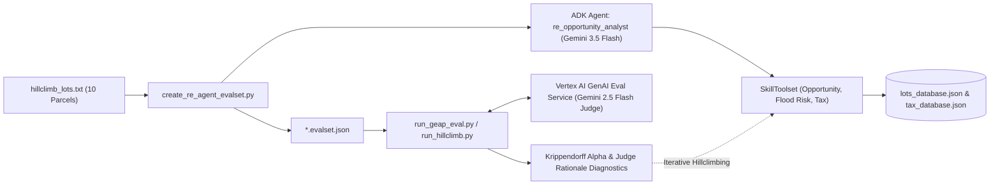

# FDE: Hillclimbing with Autoraters Challenge Lab

End-to-end solution, evaluation harness, and architectural runbook for the **Forward Deployed Engineering (FDE): Hillclimbing with Autoraters Challenge Lab**, built with **Google Agent Development Kit (`google-adk==2.4.0`)** and **Vertex AI GenAI Evaluation Service (`GEAP`)**.

📘 **[Read the Full Step-by-Step Lab Runbook, Architecture Diagrams & Workflow (`LAB_RUNBOOK.md`)](./LAB_RUNBOOK.md)**

---

## Highlights & Results

1. **Statistical Autorater Calibration (`Krippendorff's Alpha`)**:
   Evaluated 19 candidate pointwise rubrics across multi-pass LLM-as-a-Judge runs (`gemini-2.5-flash`, `sampling_count=4`) and isolated the top 3 high-reliability, high-discrimination criteria (`best_criteria_submission.txt`):
   - `monthly-tax-holding` ($\alpha = 0.9970$, Pairwise Agreement $= 99.17\%$, Report SD $= 0.8872$)
   - `flood-zone-flagging` ($\alpha = 0.8970$, Pairwise Agreement $= 94.41\%$, Report SD $= 0.3357$)
   - `environmental-esa` ($\alpha = 0.8970$, Pairwise Agreement $= 79.10\%$, Report SD $= 0.7042$)

2. **Agent Hillclimbing (`gemini-3.5-flash` Real Estate Investment Analyst)**:
   Diagnosed low-scoring criteria using judge rationales (`explain_criteria_results.py`) and upgraded `analyze-opportunity/SKILL.md`, `analyze-flood-risk/SKILL.md`, and `re_analyst/agent.py` to climb from baseline `1.00` to a **perfect `5.0000 / 5.0000`** across all 10 evaluation properties:

| Iteration | `cost-per-acre` Mean | `neighboring-flood-risk` Mean | Notes |
| :--- | :---: | :---: | :--- |
| `hillclimb_1` | `1.0000` | `1.0000` | Baseline ADK agent |
| `hillclimb_2` | `1.1000` | `1.2000` | Baseline stochastic variance check |
| **`hillclimb_3`** | **`5.0000`** | **`5.0000`** | **Refined ADK Skills + System Instructions** |

---

## Architecture Overview



---

## Quickstart

```bash
# 1. Configure Python 3.13+ and install dependencies
python3 -m pip install -r requirements.txt

# 2. Configure Vertex AI environment variables
cp .env.example .env
# Edit .env and set GOOGLE_CLOUD_PROJECT=<your-gcp-project-id>

# 3. Generate ADK evaluation traces
python3 -m eval_harness.create_re_agent_evalset \
  --lots-file eval_harness/hillclimb_lots.txt \
  --out ./re_analyst/hillclimb_lots.evalset.json \
  --agent-dir ./re_analyst

# 4. Analyze multi-pass rubric reliability (Krippendorff's Alpha)
python3 -m eval_harness.all_criteria_analysis \
  --run_geap_eval_out runs/geap_calls_and_responses_for_analysis.json

# 5. Execute an automated hillclimbing iteration
python3 -m eval_harness.run_hillclimb
```

For detailed instructions, sequence diagrams, root-cause diagnostics, and exact skill modifications, see **[`LAB_RUNBOOK.md`](./LAB_RUNBOOK.md)**.
